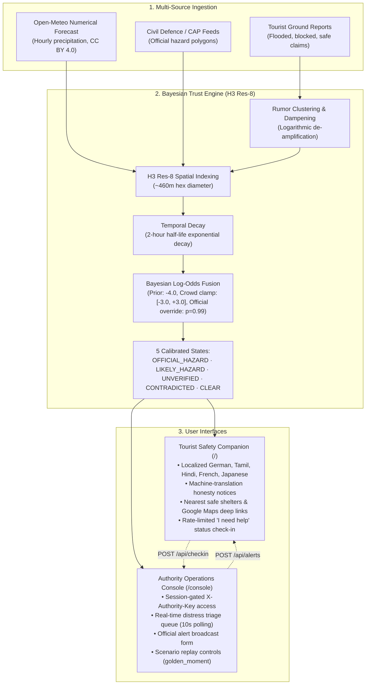

# StreetVerism

> **Multi-Source Bayesian Trust Engine & Crisis Action Companion for Tourists During Extreme Weather**  
> Built for the 24-hour Hackathon (Track: TravelTech) at IIITDM Kancheepuram.

[](tests/)
[](web/)
[](web/)

---

## 1. Problem Statement

During localized flash floods, cyclones, and tropical storms, foreign tourists face severe vulnerabilities:
- **Unfamiliar Geography**: Lack of knowledge regarding local terrain, low-lying drainage basins, and safe shelter locations.
- **Language Barriers**: Urgent civil defence advisories are often broadcast solely in local regional languages.
- **Viral Misinformation**: Social media panic, misleading viral claims, and outdated photos cause chaotic crowd movements into hazardous roads.
- **First Responder Overload**: Distressed tourists struggle to communicate their location and group status, overburdening emergency hotlines.

---

## 2. Our Solution

**StreetVerism** bridges this gap through a dual-sided architecture:
1. **Bayesian Spatial Trust Engine**: Synthesizes open numerical weather predictions, official Common Alerting Protocol (CAP) polygons, and clustered crowd observations into posterior hazard probabilities per Uber H3 resolution-8 hexagonal cell.
2. **Tourist Safety Companion**: A zero-install web client offering localized emergency advisories, machine translation transparency, nearest open shelters with one-tap Google Maps navigation, and privacy-preserving emergency check-in triage.
3. **Authority Operations Console (`/console`)**: A unified dispatch interface allowing disaster operators to triage distress requests, publish verified advisories, and control historical scenario simulations.

---

## 3. Architecture



---

## 4. How the Trust Engine Works

The trust engine computes a posterior probability of hazard $p(\text{hazard} \mid E)$ for every Uber H3 resolution-8 hexagonal cell (~0.73 km² area, ~460m edge length) in the coverage zone using Bayesian log-odds synthesis.

### Real Mathematical Constants (from Code)
- **Prior Log-Odds**: `PRIOR_LOG_ODDS = -4.0` ($\approx 1.8\%$ prior baseline probability).
- **Temporal Half-Life Decay**: `HALF_LIFE_S = 7200.0` seconds (2 hours). Evidence weight decays exponentially over time: $w(t) = w_0 \cdot 2^{-\Delta t / 7200}$.
- **Crowd Logit Clamp**: `CROWD_LOGIT_MIN = -3.0`, `CROWD_LOGIT_MAX = +3.0`. Prevents uncorroborated social media volume from overwhelming official evidence.
- **Cluster De-Amplification**: Multiple social reports within the same H3 cell are clustered and de-amplified logarithmically: $w_{\text{cluster}} = w_{\text{base}} \cdot (1 + 0.5 \cdot \ln(1 + n))$. 50 viral tweets do not equal 50 independent field confirmations.
- **Official Authority Override**: When an official emergency alert polygon intersects a cell, it carries an overwhelming evidence weight (`OFFICIAL_EVIDENCE_WEIGHT = 3.5`), forcing posterior probability $p = 0.99$.
- **Status Classification Thresholds**:
  - `official_hazard`: Active official alert covers the cell ($p \ge 0.95$ with authority evidence).
  - `likely_hazard`: Corroborated posterior probability $p \ge 0.70$.
  - `unverified`: Social reports present ($p \ge 0.40$) without official corroboration.
  - `contradicted`: Official all-clear contradicts community claims.
  - `clear`: Posterior probability $p < 0.40$.

---

## 5. Technology Stack

| Layer | Technologies |
| :--- | :--- |
| **Backend** | Python 3.11, FastAPI, Uvicorn (Single Worker), Pydantic v2, SQLite |
| **Spatial Indexing** | Uber H3 (v4), Shapely (planar polygon analysis) |
| **External Data** | Open-Meteo numerical forecast API (CC BY 4.0), OpenRouteService (HeiGIT), OpenStreetMap (ODbL) |
| **Frontend** | React 19, TypeScript, Vite, Leaflet, Oxlint |
| **DevOps & Deploy** | Docker, Uvicorn reverse-proxy proxy headers, Render / Railway / Vercel SPA rewrites |

---

## 6. Setup & Installation

### Local Development Setup

#### 1. Backend
```bash
# Clone repository
git clone https://github.com/manasvivek25-spec/StreetVerism.git
cd StreetVerism

# Set up Python virtual environment
py -3.11 -m venv .venv
source .venv/bin/activate       # Linux/macOS
# or: .venv\Scripts\Activate.ps1 # Windows PowerShell

# Install dependencies
pip install -r requirements.txt

# Run pytest test suite (146 tests)
pytest

# Start live backend with replay paused at golden_moment
export MOCK=0
export REPLAY_AUTOSTART="golden_moment"
export AUTHORITY_KEY="dev-authority-secret"
uvicorn backend.app.main:app --host 0.0.0.0 --port 8000 --workers 1 --proxy-headers
```

#### 2. Frontend
```bash
cd web
npm install
npm run lint    # Oxlint check (0 errors, 0 warnings)
npm run build   # Production bundle verification
npm run dev     # Starts local Vite development server
```

### Deployed Production Run Command (Linux)
```bash
uvicorn backend.app.main:app --host 0.0.0.0 --port "${PORT:-8000}" --workers 1 --proxy-headers --forwarded-allow-ips="*"
```

### Automated Golden Path Smoke Test
```bash
python scripts/smoke.py --base-url "http://localhost:8000" --authority-key "dev-authority-secret"
```

---

## 7. Data Honesty & Disclosure Section

In accordance with ethical engineering and hackathon judging guidelines:
1. **Replay Scenario Nature**: The scenario data in `data/scenarios/michaung_replay.json` is an **illustrative reconstruction** loosely based on Cyclone Michaung (Chennai, Dec 2023). It is synthetic demonstration data, not an official or real-time civil defence broadcast.
2. **Demo Shelters**: The 4 relief centres listed in `data/shelters.json` are fictional facilities constructed for demonstration.
3. **Translation Honesty**:
   - English (`en`), Tamil (`ta`), and Hindi (`hi`) instructions are curated civil defence terms.
   - German (`de`), French (`fr`), and Japanese (`ja`) instructions are machine-translated and have not yet undergone native crisis speaker review. The UI explicitly marks these with a warning notice and provides the original English text.
4. **Weather Data Nature**: Weather features are derived from Open-Meteo numerical weather model forecast data, not real-time physical radar or rain gauge sensor networks.
5. **No Offline PWA Claims**: Full Service Worker offline caching is not yet implemented; the client operates as a responsive web application.

---

## 8. Limitations & Future Scope

- **SMS Fallback / Cell Broadcast**: Integration with emergency cell broadcast protocols and SMS two-way triage when mobile data networks fail.
- **Offline Service Worker Caching**: PWA service worker with IndexedDB tile caching for disconnected map navigation.
- **Native Speaker Localization**: Native validation of emergency instructions in additional European and East Asian languages.
- **Real-Time NDRF / SDMA CAP Feeds**: Live polling of official state disaster management authority XML feeds.
- **Dynamic Routing Quotas**: Scaling routing token bucket capacity via multi-provider failover (OpenRouteService, GraphHopper, Valhalla).

---

## 9. Documentation Links

- [Frozen API Contract (docs/API.md)](docs/API.md)
- [Trust Engine Specification (docs/TRUST_ENGINE.md)](docs/TRUST_ENGINE.md)
- [Scenario Replay Guide (docs/REPLAY.md)](docs/REPLAY.md)
- [Deployment Configuration & Verification (docs/DEPLOY.md)](docs/DEPLOY.md)
- [Hackathon Presentation Demo Script (docs/DEMO.md)](docs/DEMO.md)
- [Open-Source Licenses & AI Disclosures (DISCLOSURES.md)](DISCLOSURES.md)
