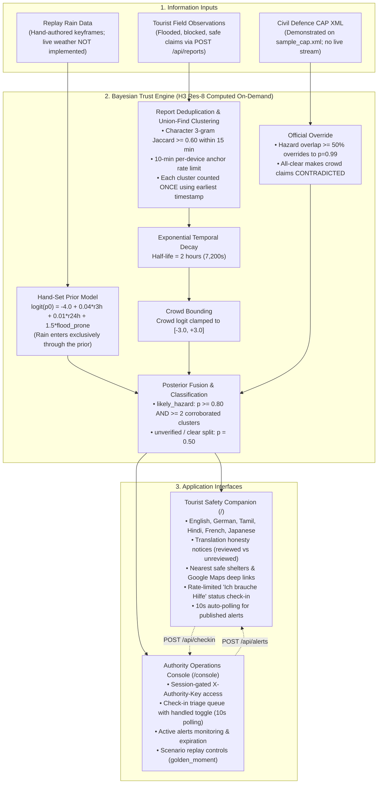

# StreetVerism

> **Multi-Source Bayesian Trust Engine & Crisis Action Companion for Tourists During Extreme Weather**  
> Built for the 24-hour Hackathon (Track: TravelTech) at IIITDM Kancheepuram.  
> *Built with AI assistance: Antigravity, Manus, Claude*

---

## 1. Problem Statement

During localized flash floods, tropical storms, and extreme monsoon inundations, foreign tourists face unique, life-threatening vulnerabilities:
- **Language Barriers**: Urgent local civil defence bulletins are typically broadcast exclusively in regional dialects.
- **Unfamiliar Local Geography**: Tourists lack knowledge of historical drainage basins, waterlogged underpasses, and emergency shelters.
- **Social Media Panic & Rumors**: Misinformation, unverified claims, and panic forwards distort ground realities, prompting dangerous travel into inundated corridors.
- **First-Responder Saturation**: Emergency hotlines become overwhelmed, making manual triage of stranded international visitors difficult.

---

## 2. Our Solution

**StreetVerism** establishes an explainable, probabilistic crisis action layer connecting tourists and emergency coordinators:
1. **Bayesian Spatial Trust Engine**: Computes posterior hazard probabilities per Uber H3 resolution-8 hexagonal cell on demand, fusing rainfall prior models, crowdsourced reports, and official hazard polygons.
2. **Tourist Safety Web Companion (`/`)**: A responsive mobile web application providing emergency instructions, transparent translation notices, nearest registered shelters with Google Maps navigation, and rate-limited status check-ins.
3. **Authority Operations Console (`/console`)**: A unified dispatch interface allowing disaster operators to triage distress check-ins in real time, broadcast verified alerts, and control historical disaster replays.

---

## 3. Architecture



---

## 4. How the Trust Engine Works

The trust engine computes a posterior probability of hazard $P(H \mid E)$ for any target Uber H3 resolution-8 hexagonal cell (~460m edge length, computed dynamically on demand) using linear Bayesian log-odds:

$$\text{logit}(P(H \mid E)) = \text{logit}(P(H)) + \sum_{i=1}^n \text{LLR}(E_i)$$

### Real Mathematical Constants & Rules (Verified from Code)

- **Hand-Set Prior Model**:
  $$\text{logit}(p_0) = -4.0 + 0.04 \cdot r_{3h} + 0.01 \cdot r_{24h} + 1.5 \cdot f_{\text{flood}}$$
  - Baseline dry-weather logit: `PRIOR_INTERCEPT = -4.0` ($p_0 \approx 0.018$ or $1.8\%$).
  - Rain coefficients: `+0.04`/mm (3-hour rain, capped at 150mm) and `+0.01`/mm (24-hour rain, capped at 400mm).
  - Low-lying / flood-prone terrain penalty: `+1.50`.
  - **Important**: These coefficients are **hand-set** heuristics tuned for the crisis replay scenario; they are **not** statistically fitted from large historical datasets.
  - **Rain Independence**: Rain enters **exclusively** through the prior. The rainfall line in the evidence breakdown is display-only.
- **Crowd Reporter Calibration**:
  - Default observer ($s=0.70, q=0.85$): $\text{LLR}_+ \approx +1.5404$, $\text{LLR}_- \approx -1.0415$.
  - Verified local ($s=0.90, q=0.95$): $\text{LLR}_+ \approx +2.8904$, $\text{LLR}_- \approx -2.2513$.
- **Deduplication & Union-Find Clustering**:
  - Per `(device_id, cell)` anchor rate-limiting keeps at most one report per 10-minute (`600s`) window.
  - Pairwise character 3-gram Jaccard similarity $\ge 0.60$ inside a 15-minute (`900s`) sliding window merges reports into transitive clusters.
  - **Each cluster is counted ONCE**, contributing the member with the largest $|LLR|$ and using the cluster's **earliest** timestamp (re-posted rumors do not reset freshness).
- **Exponential Decay**:
  - Half-life $T_{1/2} = 7,200\text{ seconds}$ (2 hours), $\lambda = \frac{\ln 2}{7200}$.
  - Weight decays as $\exp(-\lambda \cdot \Delta t)$. Active threshold: $\le 6\text{ hours}$; corroborated threshold: $\le 4\text{ hours}$.
- **Crowd Logit Clamp**:
  - Total crowd evidence is strictly clamped to `[-3.0, +3.0]`, mathematically preventing rumor mobs from creating artificial certainty.
- **Official Authority Overrides**:
  - Official alerts are evaluated via spatial polygon class union. If official hazard overlap covers $\ge 50\%$ of the cell area, status is overridden to `official_hazard` ($p = 0.99$, `OFFICIAL_EVIDENCE_WEIGHT = 3.5`).
  - An official all-clear covering $\ge 50\%$ forces status `clear` ($p = 0.01$); if active crowd hazard claims remain, it is categorized as `contradicted`.
- **Classification Rules**:
  - `likely_hazard`: $p \ge 0.80$ **AND** $\ge 2$ corroborated positive clusters.
  - `contradicted`: Active positive claims exist **AND** (official all-clear covers cell **OR** [$p_{\text{prior}} < 0.05$ with fresh rain data and $< 2$ corroborated clusters]).
  - `unverified`: Active positive claims exist (neither likely nor contradicted); **OR** no claims but $p \ge 0.50$.
  - `clear`: $p < 0.50$ and no active positive claims.

---

## 5. Feature Verification & Implementation Status

To maintain strict technical honesty, every feature mentioned across documentation is verified against the repository:

| Feature / Claim | Status | Repository Evidence | Notes / Truth in Code |
| :--- | :--- | :--- | :--- |
| **Bayesian Log-Odds Trust Engine** | ✅ **Implemented** | `backend/app/trust/engine.py` | Matches derivation; hand-set constants; Union-Find clustering. |
| **Historical Scenario Replay** | ✅ **Implemented** | `backend/app/scenario/` | Paused at `golden_moment` on boot (`REPLAY_AUTOSTART=golden_moment`). |
| **Safe Routing via OpenRouteService** | ✅ **Implemented** | `backend/app/routing/ors_adapter.py` | Integrates ORS v2 API; direct-line fallback on missing key or 429. |
| **Tourist Incident Report Flow** | ✅ **Implemented** | `backend/app/api/routes.py`, `web/src/App.tsx` | `POST /api/reports` with claims `flooded`, `blocked`, `safe`. |
| **Rate Limiting & Proxy IP Handling** | ✅ **Implemented** | `backend/app/api/routes.py` | Dual-key token bucket with `X-Forwarded-For` inspection. |
| **Check-in Wall-Clock Retention** | ✅ **Implemented** | `backend/app/services/checkin_service.py` | Timestamps use real wall-clock UTC; 48-hour background purge. |
| **Authority Operations Console** | ✅ **Implemented** | `web/src/console/ConsoleApp.tsx` | Password-gated triage dashboard, alerts manager, replay controls. |
| **Live Weather Data Ingestion (A4)** | ❌ **Not Implemented** | `backend/app/services/state_service.py` | Live mode returns `weather_available: false`. Replay uses keyframes. |
| **Live CAP Feed Ingestion (A5)** | ❌ **Not Implemented** | `backend/mock_data/sample_cap.xml` | CAP 1.2 XML parser verified on demo XML file; no live feed polling. |
| **Pre-indexing All of Chennai** | ❌ **Not Implemented** | `backend/app/geo/h3_utils.py` | H3 resolution-8 cells are generated dynamically on demand. |
| **Offline PWA / Service Worker** | ❌ **Not Implemented** | `web/` | Responsive web application; no offline Service Worker caching. |
| **QR Code Landing Page** | ❌ **Not Implemented** | `web/` | No QR code generator or dedicated QR scan route. |
| **Live Continuous GPS Tracking** | ❌ **Not Implemented (By Design)** | `backend/app/` | Zero-tracking policy. Single one-time client GPS reading. |
| **Native Human-Reviewed Translations** | ⚠️ **Partial** | `data/templates/` | English (`en`) verified. Tamil (`ta`), Hindi (`hi`), German (`de`), French (`fr`), Japanese (`ja`) unreviewed. |

---

## 6. Live Deployments & Judge Access

- **Public Tourist App URL**: [https://street-verism.vercel.app/](https://street-verism.vercel.app/)
- **Public Authority Console**: [https://street-verism.vercel.app/console](https://street-verism.vercel.app/console)
- **Public Backend API**: [https://streetverism.onrender.com/](https://streetverism.onrender.com/)
- **Demo Video Link**: `docs/demo.mp4 (to be added)`

### Judge Access
To evaluate the Authority Operations Console at [https://street-verism.vercel.app/console](https://street-verism.vercel.app/console):
1. Open the console link in any desktop or mobile browser.
2. When prompted for credentials, enter the secret:
   `<demo authority key provided in the submission form>`
   *(The production secret is securely injected into Render via the host `AUTHORITY_KEY` environment variable and is never stored in version control).*
3. Verification capabilities available in the console:
   - **Triage Check-Ins**: View distress check-in clusters and toggle handled status (`PATCH /api/checkins/{id}`).
   - **Publish Alerts**: In live mode, broadcast emergency alerts; in replay mode, verify 409 rejection protects historical replay integrity.
   - **Replay Playback Controls**: Jump to named keyframes (`golden_moment`), pause simulation clock, or reset to live operation.

---

## 7. Setup & Configuration

### Environment Variables

| Variable | Required | Default | Purpose |
| :--- | :--- | :--- | :--- |
| `MOCK` | No | `1` | `0` for live operational database & replay; `1` for deterministic mock data. |
| `AUTHORITY_KEY` | **Yes (in MOCK=0)** | *None* | Secure secret for administrative `/console` access and `/api/checkins`. |
| `REPLAY_AUTOSTART` | No | `""` | Set to `golden_moment` to seed the peak emergency replay state paused. |
| `CORS_ORIGINS` | No | `*` | Allowed CORS origins (e.g. `https://street-verism.vercel.app`). |
| `DATABASE_URL` | No | `sqlite:///./streetverism.db` | SQLite database URI. |
| `SERVICE_BBOX` | No | `80.10,12.80,80.40,13.30` | Spatial bounding box for Chennai coverage. |
| `ROUTING_PROVIDER` | No | `openrouteservice` | Routing adapter name. |
| `ROUTING_API_KEY` | No | *None* | OpenRouteService API key for real road directions. |
| `ROUTING_DAILY_BUDGET`| No | `1500` | Daily request cap for routing provider. |
| `ROUTING_PER_MIN` | No | `30` | Per-minute token bucket rate limit for routing. |
| `VITE_API_BASE` | Frontend | `http://localhost:8000` | Backend API base URL for the Vite frontend build. |

### Running Locally

```bash
# 1. Backend setup
py -3.11 -m venv .venv
source .venv/bin/activate       # Linux/macOS
# or: .venv\Scripts\Activate.ps1 # Windows PowerShell

pip install -r requirements.txt
pytest                          # Runs full 146-test suite

export MOCK=0
export REPLAY_AUTOSTART="golden_moment"
export AUTHORITY_KEY="dev-authority-secret"
uvicorn backend.app.main:app --host 0.0.0.0 --port 8000 --workers 1 --proxy-headers

# 2. Frontend setup
cd web
npm install
npm run lint                    # Oxlint (0 errors, 0 warnings)
npm run build                   # Verifies clean production bundle
npm run dev -- --port 5173      # Starts Vite dev server
```

---

## 8. Honesty & Technical Limitations

1. **Ephemeral SQLite Storage**: Free-tier container restarts wipe SQLite data; distress check-ins do not survive host container recycling.
2. **Global Shared Replay Clock**: The replay simulation clock is global in-memory state; when one operator seeks or pauses the scenario, the clock changes for all concurrent users.
3. **No Live Weather Ingestion**: In live mode (`MOCK=0` without replay), live numerical weather ingestion is not connected (`weather_available: false`). The system explicitly notifies users to follow civil defence channels.
4. **Hazard-Aware Routing Boundary**: Safe routing avoids known, surveyed hazard polygons. External mapping applications (Google Maps / Apple Maps) opened via deep links do not possess flood-awareness.
5. **Synthetic Demo Data**: The 4 relief centres in `data/shelters.json` and the Cyclone Michaung timeline in `data/scenarios/michaung_replay.json` are fictional demonstration constructs.
6. **OpenStreetMap Ground Truth**: Road networks are derived from real OpenStreetMap geometries, whereas hazard zones during replay are simulated reconstructions.
7. **Translation Review Status**: Only English (`en`) has undergone native review. German (`de`), French (`fr`), Japanese (`ja`), Tamil (`ta`), and Hindi (`hi`) are marked as unreviewed machine translations.

---

## 9. Documentation Links

- [Frozen API Specification (docs/API.md)](docs/API.md)
- [Trust Engine Specification (docs/TRUST_ENGINE.md)](docs/TRUST_ENGINE.md)
- [Scenario Replay Guide (docs/REPLAY.md)](docs/REPLAY.md)
- [Deployment Configuration & Reverse Proxy Guide (docs/DEPLOY.md)](docs/DEPLOY.md)
- [2-Minute Presentation Demo Script (docs/DEMO.md)](docs/DEMO.md)
- [Third-Party Libraries & AI Disclosures (DISCLOSURES.md)](DISCLOSURES.md)

---

## 10. Team & AI Disclosure

- **Hackathon Track**: TravelTech, IIITDM Kancheepuram
- **Built with AI assistance**: Google Antigravity, Manus, Claude
